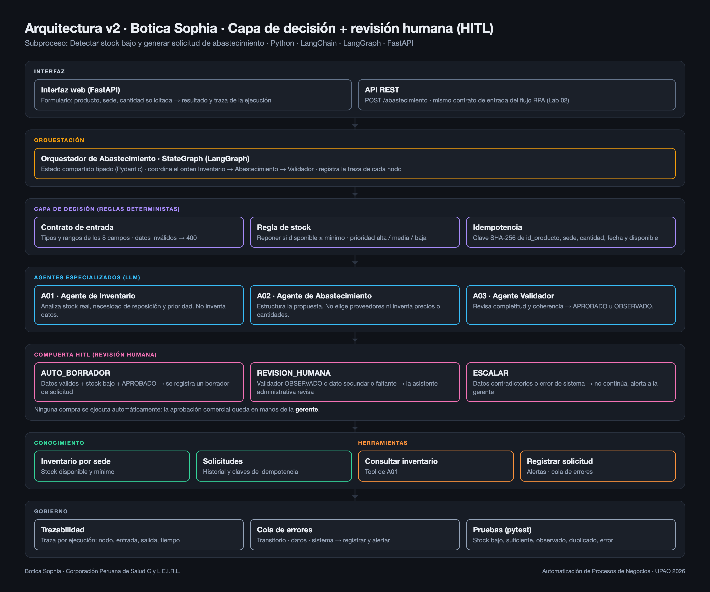

# Botica Sophia Agentic

Sistema multiagente que automatiza el abastecimiento de una botica: **detecta stock bajo y genera la
solicitud de reposición**, con revisión humana cuando hace falta.

Proyecto del curso Automatización de Procesos de Negocios (UPAO, 2026). Evoluciona los laboratorios
anteriores hechos en n8n (flujo RPA y sistema multiagente) hacia Python.

## Cómo funciona

Un orquestador en **LangGraph** pasa un estado compartido (Pydantic) por tres agentes:

1. **A01 · Inventario**: consulta el stock real y decide si hace falta reponer, con qué prioridad y cuánto.
2. **A02 · Abastecimiento**: arma la propuesta de solicitud sin inventar precios ni proveedores.
3. **A03 · Validador**: revisa la propuesta con reglas de negocio deterministas.

Al final, una **compuerta HITL** (human in the loop) registra la solicitud o la manda a revisión humana.
Incluye también un supervisor con Deep Agents, cadenas LCEL y trazabilidad con LangSmith.



## Tecnologías

LangGraph · LangChain · Groq · FastAPI · Pydantic · pytest · uv

## Ejecutar

```bash
cp .env.example .env          # pon tu GROQ_API_KEY
uv sync
uv run pytest -q              # 118 pruebas, sin llamar al LLM real
uv run uvicorn botica.api.main:aplicacion --reload   # http://127.0.0.1:8000
```

Los datos de inventario son de ejemplo.

---
Willian Axel Polo Luján · [axelpolo.pe](https://axelpolo.pe)
